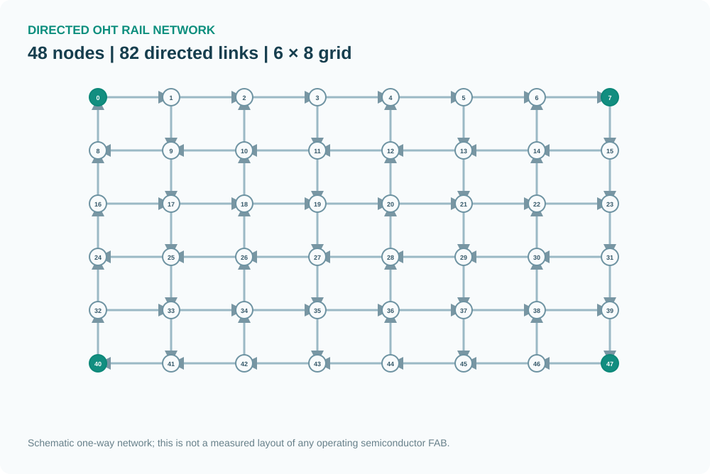
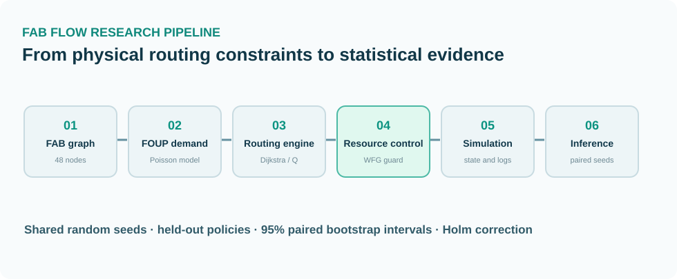
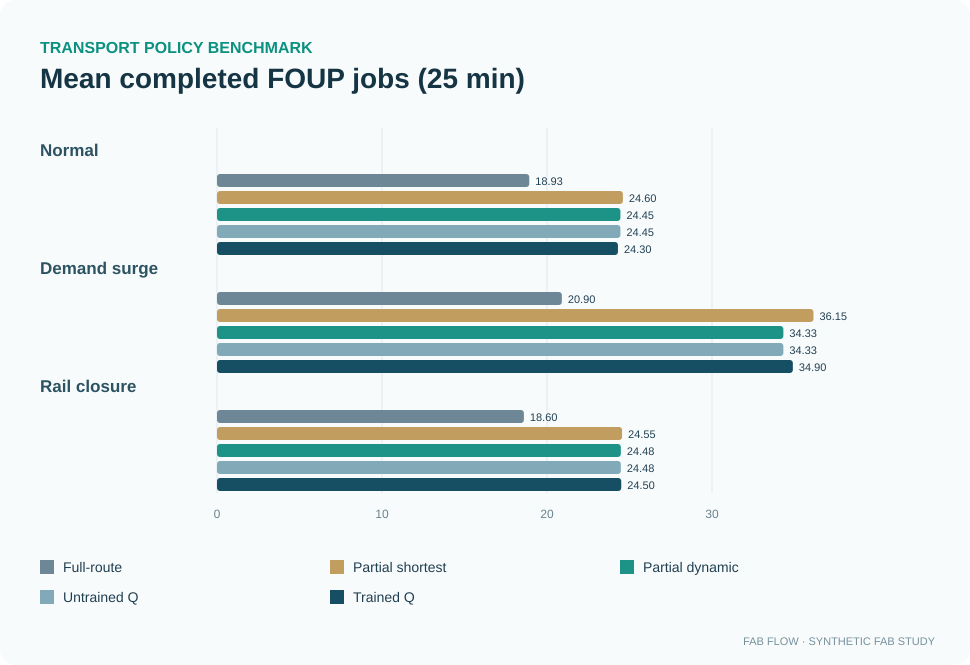
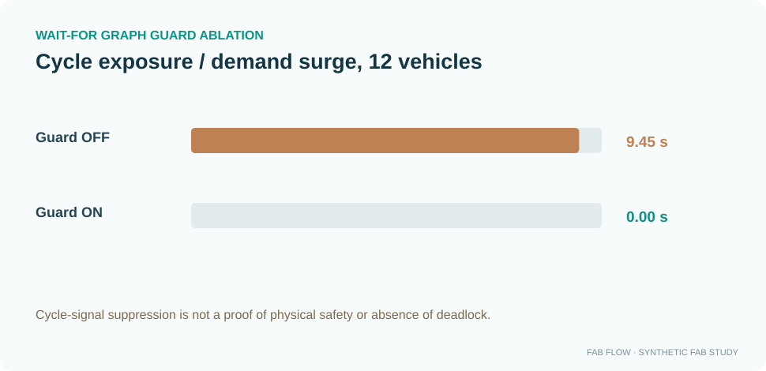

# FAB FLOW
## Deadlock-Aware OHT Routing and Partial Rail Reservation in a Synthetic Semiconductor FAB

**Personal Research / Semiconductor Material Handling / Operations Research**

**Seminar context:** Learners × YPICS Joint Logistics Seminar — 31 October 2026, 14:00 (**presentation preparation; not a completed presentation**).

[Interactive research web](https://fabflow-oht-phase3-deadlock.vercel.app/) · [Official joint-seminar notice](https://www.instagram.com/p/De6u9tXj2_h/) · [Full technical README](../README.md) · [English overview](../README_EN.md)

### 01 | Motivation

A shortest individual OHT path does not necessarily improve the throughput of the entire fab. Multiple autonomous carriers share overhead links and intersections. Overly conservative resource locking prevents conflicts at the cost of blocking portions of the network that a vehicle may not need for some time.

**Question:** Can a partial next-segment reservation controller improve completed FOUP transport jobs while observing collision-avoidance invariants? Does a trained routing policy improve further after the reservation architecture is held constant?

### 02 | Study architecture

A synthetic 48-node, 82-directed-link graph models OHT transport requests, shared nodes, edge reservations, route choices, service times, and the end-of-horizon work backlog. This network is not a real semiconductor-fab floorplan.

**Policies:** Atomic full-route lock; partial shortest-path routing; congestion-aware partial routing; untrained tabular-Q action selection; trained tabular-Q action selection.

**Design:** Three scenarios (normal, 1.5× request demand, link closure), forty common random seeds per scenario and policy, twenty-five-minute observation, nine vehicles for the main evaluation. The result is 600 main evaluation runs. Fleet-size and guard sensitivity contributed 360 further runs.

### 03 | Measured outcomes

| Condition | Full-route lock | Partial dynamic | Trained Q |
|---|---:|---:|---:|
| Normal | 18.925 | 24.450 | 24.300 |
| Demand surge | 20.900 | 34.325 | 34.900 |
| Rail closure | 18.600 | 24.475 | 24.500 |

Units: completed FOUP transport jobs per 25-minute evaluation, averaged over 40 runs. Synthetic output only.

The simulated partial-reservation controller completed an additional **5.525**, **13.425**, and **5.875** tasks in normal, surge, and closure scenarios, respectively, compared with the full-route reservation baseline. The corresponding 95% paired-bootstrap confidence intervals excluded zero.

The *additional learned-Q contribution* was much smaller: **−0.150** (normal), **+0.575** (surge), and **+0.025** (closure) jobs compared with the untrained Q controller. Only the surge case provided a confidence interval excluding zero: **[+0.200, +1.000] jobs**, Holm-adjusted sign-test p = **0.0369**.

### 04 | Guard and safety conditions

An additional wait-for graph check screens potential circular waiting relationships between OHTs. In the surge / 12-vehicle sensitivity test, cycle-signal exposure decreased from **9.45 seconds per run** to **zero** in the evaluated model. The signal describes modeled dependencies, not proof of permanently deadlocked physical machines.

### 05 | Findings & limits

**Main finding:** In the simulated conditions, *resource-allocation structure* had a larger measured effect on completion throughput than Q-learning itself. A trained Q policy showed a small, condition-specific gain but not consistent superiority.

**Limitations:** Simplified synthetic geometry and OHT kinetics, no synchronized factory measurements, no PLC/MES integration, no industrial safety certification, and no guaranteed generalization beyond the tested graph. The public web interface is an explanatory SVG-based visualization, not live sensor-driven digital twinning.

**Project resources:** [Bilingual technical documentation](../README.md) · [Statistics CSV](../results/paired_inference.csv) · [Mean outcomes](../results/summary_600.csv)
